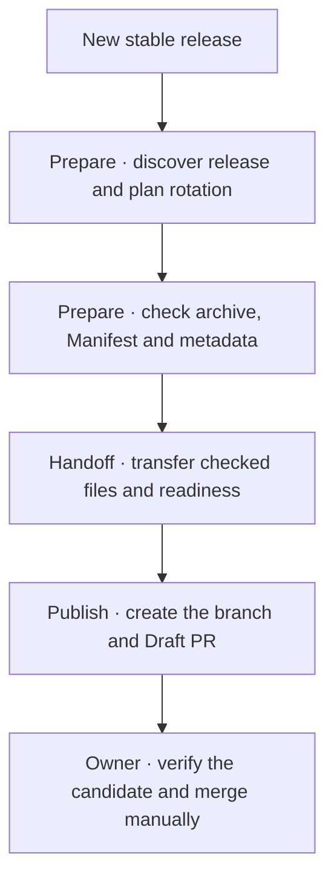

# How a Noctalia release becomes a Draft PR

[Русский](AUTOMATION.md) · [Install the overlay](../README.en.md) ·
[CI, security and recovery](CI_AND_SECURITY.en.md)

## What the automation does

Each new stable release needs a reviewable change: a new ebuild, a previous
version for rollback, and a Manifest covering both. The automation applies
the same rotation rules each time and saves the version, archive and file
checks for the owner to review.



Prepare reads GitHub and works on a temporary overlay copy on the runner.
Uploading the artifact stores the files in GitHub Actions. The branch and
PR are created by a separate Publish job with repository write access.
This keeps that access out of source downloads and Gentoo checks. The
owner verifies the exact candidate, its dependencies and the installed
session before merging. Only the merge makes the candidate an accepted version.

## Source map

The [release workflow](../.github/workflows/noctalia-release-watcher.yml)
sets the order of the steps and passes results between them. Each script
handles part of that flow.

- [`overlay_policy.py`](../scripts/overlay_policy.py) reads the ebuild
  versions and checks both README tables against them.
- [`watch_noctalia_release.py`](../scripts/watch_noctalia_release.py)
  finds the release, establishes tag provenance and supplies the GitHub API client.
- [`prepare_noctalia_release.py`](../scripts/prepare_noctalia_release.py)
  plans and applies the package rotation.
- [`release_handoff.py`](../scripts/release_handoff.py) verifies sources,
  the Manifest and transferred files, and records and checks publication readiness.
- [`publish_noctalia_release.py`](../scripts/publish_noctalia_release.py)
  admits the checked candidate and creates the commit, branch and Draft PR.

## Reading the workflow

The release workflow runs daily at 06:17 UTC on `schedule` and manually
through `workflow_dispatch`. A manual run with `dry_run=true` checks
discovery and shows the plan. If an eligible update exists, Prepare makes
a temporary copy and plans the rotation without changing the package
files. Unit tests run after successful discovery and the eligibility step.
Dry runs skip the archive, Gentoo, artifact upload and Publish.

Steps within a job run in order. An `id` lets a later step refer to that
step by name. `run: |` supplies a multiline Bash command, while `uses`
runs an Action. GitHub evaluates `${{ ... }}` expressions before the
command runs. For example, `env` puts the discovered tag into the process
environment, where Bash reads it as `$RELEASE_TAG`.

```yaml
env:
  RELEASE_TAG: ${{ steps.watch.outputs.release_tag }}
```

`--github-output "$GITHUB_OUTPUT"` names the file GitHub reads for
`name=value` pairs. `--summary "$GITHUB_STEP_SUMMARY"` names a separate
file for the human-readable report. Source validation starts once
publication is eligible and the rotation has actually been applied.

```yaml
if: steps.eligibility.outputs.publish_ready == 'true' && steps.rotation.outputs.outcome == 'prepared'
```

`steps.rotation.outcome` describes whether the command ran successfully.
A dry run can return `success`. `steps.rotation.outputs.outcome` describes
what the rotation did. `needs: prepare` makes publishing depend on the
whole Prepare job. Publish also checks its run context and receives
`needs.prepare.outputs.readiness` only after the required steps succeed.
Check each applicable step in the Prepare report. A successful job with
skipped steps supplies evidence only for the checks that ran.

## Discover the release

`watch()` first requests the latest GitHub Release and checks its URL,
its `vX.Y.Z` tag, and that the draft and prerelease flags are false. It
then resolves the tag to a full commit SHA and checks `VERSION` at that
commit. After that it reads the accepted overlay state through
`validate_overlay()` and compares numeric versions. This way a bad tag
still causes an error when the version is already packaged.

A lightweight tag points directly to a commit. An annotated tag points
to a separate object with the tag name, target commit and verification
metadata. The watcher compares those fields and records GitHub's result.
When GitHub reports `verified: true`, the watcher requires `reason: valid`,
checks the shape of the OpenPGP signature, and compares the signed
`object`, `type` and `tag` headers with the tag object. Lightweight
tags and consistent annotated tags with `verified: false` are accepted.
Independent cryptographic verification with the signer's key is outside
this flow.

For a newer release the watcher searches for an open PR by title and,
if needed, by the exact candidate branch. If there is no conflict, it
resolves the tag for the current ebuild and checks its `VERSION`.
`packaging_changes()` compares `PACKAGING.md`, `meson.build` and
`meson_options.txt` at the two exact commits. The result goes into the
review evidence. Network failures, incomplete PR responses, invalid tags,
invalid `VERSION` or invalid overlay state stop the candidate with an error.

The versions in these examples are hypothetical. Suppose the overlay
has **8.1.0** and fallback **8.0.0**, and GitHub returns
`tag_name: v8.2.0`, `draft: false` and `prerelease: false`. After
validation the watcher writes `$RUNNER_TEMP/noctalia-release.json`. This
excerpt shows its decision and the release identity.

```json
{
  "outcome": "release-available",
  "packaged_version": "8.1.0",
  "release": {
    "tag": "v8.2.0",
    "version": [8, 2, 0],
    "url": "https://github.com/noctalia-dev/noctalia/releases/tag/v8.2.0"
  }
}
```

- `up-to-date` means the latest eligible version or a newer one is already packaged.
- `already-reported` means a conflicting PR is open.
- `dry-run` means a new update was found and only a plan was requested.
- `release-available` means an update is available for ordinary preparation.

The step outputs are `outcome`, `release_tag` and `has_update`. The last
is `true` for `dry-run` and `release-available`. See `watch()` and
`result_payload()` in the [watcher](../scripts/watch_noctalia_release.py).

## Prepare the package rotation

`overlay_policy.py` reads the pair from the ebuild names, sorts the
versions numerically and checks the README tables. `plan_rotation()`
works out which files an update would affect. In the example, the plan
retains **8.1.0** as fallback, removes **8.0.0** and copies the current
ebuild to **8.2.0**. `prepare_release()` either returns that plan or
applies it and regenerates both blocks between the `noctalia-versions`
markers from the new tree.

The workflow passes a temporary copy with no `.git` or links. The
accepted tree and checkout metadata stay outside Gentoo's working copy.
`up-to-date` means no rotation is needed, `dry-run` means a plan was
produced without changing package files, and `prepared` means the
rotation was applied. When there is a plan, the script also writes
`removed_version`, `fallback_version` and `candidate_version`.
[Rotation code](../scripts/prepare_noctalia_release.py) ·
[Rotation tests](../tests/test_prepare_noctalia_release.py)

## Validate the archive and Manifest

A source archive is a downloadable copy of the release files. A Git tag
is a ref and can be moved. `verify-source` checks that the ebuild has the
exact canonical `SRC_URI` line and downloads the tag archive over HTTPS
to a fresh `DISTDIR`, Portage's directory for downloaded sources.
The example uses `https://github.com/noctalia-dev/noctalia/archive/v8.2.0.tar.gz`.
The check reads the full gzip and tar to detect damage or truncation after the
header. It then compares the Git tar commit ID and the PAX comment in
the tar metadata with the SHA from Discover. The link to the source tree
rests on GitHub's canonical archive service over HTTPS and matching
metadata. The check does not independently reconstruct the Git tree.

The script records the download's size and BLAKE2B and SHA512 checksums.
These hashes let Prepare and Publish compare the bytes at different
stages.

Inside the container, `/overlay` is the temporary overlay copy mounted
with write access. `/distfiles` holds the verified archive and is mounted
read-only. `ebuild … manifest` reads the archive from `/distfiles` and
records its name, size and hashes in the Manifest. That file stays in the
temporary overlay copy after the container exits. The command
`emerge --oneshot dev-util/pkgcheck` installs the tool inside the container
only. Then `pkgcheck scan --exit` checks overlay metadata and policy and
signals failure with its exit status.

```text
DIST noctalia-8.2.0.tar.gz 12345 BLAKE2B <hash> SHA512 <hash>
```

This line is schematic. After the container exits, `verify-manifest`
rechecks the archive bytes and its `DIST` line, and compares the retained
fallback line with the accepted base. This keeps the bytes Portage
trusts for rollback unchanged. Candidate preparation validates metadata
and the source. Dependency resolution, a Noctalia build, installation
and runtime checks require separate owner actions.
[Workflow checks](../.github/workflows/noctalia-release-watcher.yml) ·
[Source and Manifest code](../scripts/release_handoff.py)

## Hand off the result

Prepare and Publish run in separate environments. The handoff transfers
the checked result as an artifact, a ZIP stored by GitHub Actions. It
contains the candidate ebuild, Manifest, both READMEs and `release.json`.
That JSON records the schema version, the base commit, rotation, release
and provenance details, upstream packaging changes, branch and PR title.
This is an excerpt of schema v2 with an example base SHA.

```json
{
  "schema_version": 2,
  "release_tag": "v8.2.0",
  "base_commit": "aaaaaaaaaaaaaaaaaaaaaaaaaaaaaaaaaaaaaaaa",
  "candidate_version": "8.2.0",
  "fallback_version": "8.1.0",
  "removed_version": "8.0.0",
  "branch": "automation/noctalia-v8.2.0"
}
```

`readiness` is a separate admission record. The `ready` step creates it
after the required steps and upload succeed. `run` identifies the workflow
run, `attempt` its execution attempt, `artifact` the specific ZIP upload
and `digest` the SHA-256 of that ZIP's bytes. `base` ties it to the checked
checkout and the handoff's `base_commit`. `source` contains the candidate
identity, commit and source archive evidence, while `gates` records the
required checks. The ZIP hash and the source archive hashes refer to
different files.

Before writing to GitHub, Publish checks the admission record against the run context, downloads by exact artifact ID, and rechecks
the digest, paths, file types and candidate's base before applying it.
[Handoff creation and admission code](../scripts/release_handoff.py)

## Publish the Draft PR

Open [`publish_candidate()`](../scripts/publish_noctalia_release.py#L147) and
read it top to bottom. The workflow runs `preflight` first to get the
exact download ID, then `publish` repeats the admission checks.

1. `publication_preflight()` verifies the trusted context, `readiness`
   and a clean checkout at the recorded base.
2. The script checks the fetch and push URLs of `origin`. This ties local
   work to the intended repository.
3. `unpack_verified_artifact()` checks the ZIP's SHA-256 and extracts
   only the expected files to a new directory.
4. `validate_and_apply_candidate()` checks the Manifest, ebuild and
   generated tables against the base and applies them through `apply_handoff()`.
5. `stage_candidate()` puts changes into the Git index, which holds the
   contents of the next commit. It verifies paths, operations, bytes and
   file modes, then `git write-tree` identifies the tree, a snapshot of those files.
6. After creating a local commit, the script checks its tree and parent.
   The parent must be the base on which the candidate was validated.
7. `check_pr_conflicts()` looks up open PRs by title and all PRs by exact
   branch. `git ls-remote` reads remote refs, the branch names and their
   current SHAs. The candidate branch must be absent and `main` at the base.
8. `create_remote_branch()` runs `git push --porcelain` for a machine-readable
   result. In `--force-with-lease=<ref>:` the value after the colon is
   empty, so Git expects an absent ref. This lease only permits creation.
   The script requires `[new branch]` to confirm it.
9. Before requesting a PR, it checks conflicts, remote `main` and the
   candidate head again. The state can change between push and PR creation.
10. `create_draft()` requests a Draft PR with evidence and a manual
    checklist, and checks the response against the expected head and base.
11. On success the summary includes the PR URL. After a partial failure
    `report_partial_publication()` records the state seen on read-back and
    the last confirmed action. Follow the
    [recovery procedure](CI_AND_SECURITY.en.md#troubleshooting-and-recovery).

## Practice on a local copy

Use Python 3, Git and a checkout of the overlay. Run the commands from
its root. The tests use the Python standard library and temporary local
directories. They need no Portage, tokens or network access.
`PYTHONDONTWRITEBYTECODE=1` keeps Python from writing bytecode into the checkout.

### Run the full suite and the rotation tests

```bash
PYTHONDONTWRITEBYTECODE=1 python3 -m unittest discover -s tests
PYTHONDONTWRITEBYTECODE=1 python3 -m unittest discover -s tests -p test_prepare_noctalia_release.py -v
```

`discover -s tests` finds tests in `tests/`. `-p` selects one file and
`-v` shows scenario names. Expect `OK` from both commands. In the second
run, compare the plan, applied rotation and repeat-run outcomes with
`prepare_release()` and the [rotation tests](../tests/test_prepare_noctalia_release.py).

### Preview a rotation on a snapshot

This exercise also needs Bash, `mktemp` and `tar`. If the checkout already
packages 8.2.0 or later, substitute a higher hypothetical tag. The plan
uses the actual ebuilds in the snapshot, so the starting versions may
differ from the walkthrough example.

```bash
(
  set -eu
  work=$(mktemp -d)
  printf 'Temporary directory: %s\n' "$work"
  mkdir "$work/overlay"
  git archive HEAD | tar -xf - -C "$work/overlay"
  PYTHONDONTWRITEBYTECODE=1 python3 scripts/prepare_noctalia_release.py \
    --repository-root "$work/overlay" --release-tag v8.2.0 --dry-run \
    --github-output "$work/outputs" --summary "$work/summary"
  cat "$work/outputs" "$work/summary"
)
```

`git archive HEAD` takes the committed files. `tar` extracts them to the
temporary directory. `--repository-root` selects the snapshot,
`--release-tag` sets the candidate, and `--dry-run` limits the operation
to planning. Expect `outcome=dry-run`, the three versions and the message
`Planned rotation (package files unchanged)`. The report and copy stay in
the printed directory. The original checkout and the snapshot's package
files stay unchanged. Compare the result with `plan_rotation()` and
`summary_lines()` in the [rotation script](../scripts/prepare_noctalia_release.py).

### Trace a publication conflict

```bash
PYTHONDONTWRITEBYTECODE=1 python3 -m unittest discover -s tests \
  -p test_publish_noctalia_release.py -k closed_exact_head_conflict -v
```

`-k` selects tests by a substring of the name. The two scenarios should
return `OK`. The first checks that a closed PR for the same branch stops
publication before push. The second introduces that conflict after
confirmed branch creation and before the Draft PR request. The tests
create a disposable local Git remote and supply fake GitHub responses.
Compare the assertions in the [publication tests](../tests/test_publish_noctalia_release.py)
with `check_pr_conflicts()` and `report_partial_publication()` in
[Publish](../scripts/publish_noctalia_release.py).
