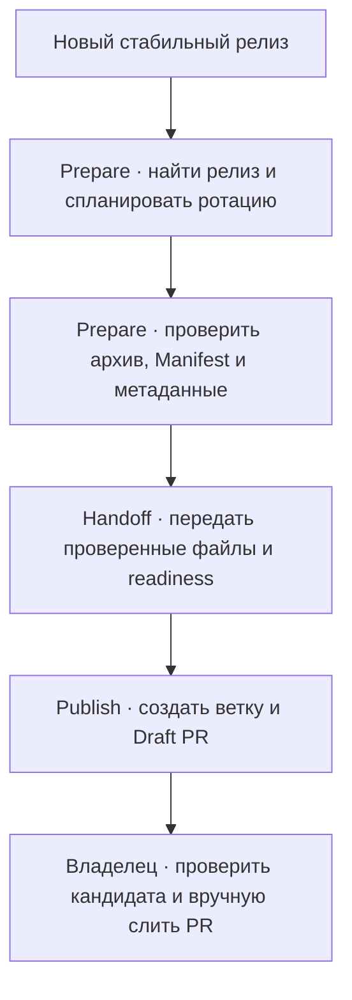

# Как Noctalia проходит от релиза до Draft PR

[English](AUTOMATION.en.md) · [Установка оверлея](../README.md) ·
[CI, безопасность и восстановление](CI_AND_SECURITY.md)

## Что делает автоматизация

Для каждого нового стабильного релиза нужен проверяемый набор изменений:
новый ebuild, предыдущая версия для отката и Manifest для обеих версий.
Автоматизация повторяет ротацию по одним правилам и сохраняет для
владельца результаты проверок версии, архива и набора файлов.



Prepare читает GitHub и работает с временной копией оверлея на runner.
Загрузка артефакта сохраняет файлы в GitHub Actions. Ветка и PR появляются
только в отдельном задании Publish с правами записи. Так загрузка
upstream-архива и проверки Gentoo выполняются без этих прав. Владелец
проверяет точного кандидата, зависимости и работу сеанса перед ручным
слиянием. Только после слияния кандидат становится принятой версией.

## Карта исходников

[Workflow обновления](../.github/workflows/noctalia-release-watcher.yml)
задаёт порядок шагов и передаёт результаты между ними. Скрипты выполняют
узкие части этого потока.

- [`overlay_policy.py`](../scripts/overlay_policy.py) читает версии ebuild
  и сверяет с ними обе таблицы README.
- [`watch_noctalia_release.py`](../scripts/watch_noctalia_release.py) ищет
  релиз, устанавливает происхождение тега и содержит клиент GitHub API.
- [`prepare_noctalia_release.py`](../scripts/prepare_noctalia_release.py)
  планирует и применяет ротацию пакета.
- [`release_handoff.py`](../scripts/release_handoff.py) проверяет исходники,
  Manifest и передаваемые файлы, записывает и проверяет допуск к публикации.
- [`publish_noctalia_release.py`](../scripts/publish_noctalia_release.py)
  принимает проверенного кандидата, создаёт коммит, ветку и Draft PR.

## Как читать workflow

Релизный workflow запускается ежедневно в 06:17 UTC по `schedule` и
вручную через `workflow_dispatch`. При ручном запуске `dry_run=true`
позволяет проверить поиск релиза и увидеть план. При наличии подходящего
обновления Prepare создаёт временную копию и строит план без изменения
файлов пакета. Unit-тесты запускаются после успешного Discover и шага
допуска. Архив, Gentoo, загрузка артефакта и Publish в dry-run пропускаются.

Шаги внутри задания идут сверху вниз. `id` позволяет обратиться к шагу
по имени из следующего шага. `run: |` передаёт многострочную команду Bash,
а `uses` запускает Action. GitHub подставляет значения выражений
`${{ ... }}` до запуска команды. Например, `env` передаёт тег из
Discover в окружение процесса, где Bash читает его как `$RELEASE_TAG`.

```yaml
env:
  RELEASE_TAG: ${{ steps.watch.outputs.release_tag }}
```

`--github-output "$GITHUB_OUTPUT"` указывает файл, из которого GitHub
читает пары `имя=значение`. `--summary "$GITHUB_STEP_SUMMARY"` указывает
другой файл для отчёта человеку. Проверка исходника начинается после
допуска к публикации и фактического применения ротации.

```yaml
if: steps.eligibility.outputs.publish_ready == 'true' && steps.rotation.outputs.outcome == 'prepared'
```

`steps.rotation.outcome` говорит, как отработала команда. Значение
`success` возможно и у dry-run. `steps.rotation.outputs.outcome` говорит,
что сделала ротация. Для публикации `needs: prepare` задаёт зависимость
от всего задания. Publish дополнительно проверяет контекст запуска и
получает `needs.prepare.outputs.readiness` только после обязательных
успешных шагов. В отчёте Prepare проверяйте каждый применимый шаг.
Общий успех с пропусками подтверждает только выполненные проверки.

## Discover — поиск релиза

`watch()` сначала запрашивает последний GitHub Release и проверяет, что у
него допустимый URL, тег в форме `vX.Y.Z` и выключены признаки draft и
prerelease. Затем находит полный SHA коммита по тегу и сверяет `VERSION`
из этого коммита. Только после этого читает принятое состояние оверлея
через `validate_overlay()` и сравнивает числовые версии. Так неверный тег
вызывает ошибку даже при уже упакованной версии.

Lightweight-тег указывает прямо на коммит. Annotated-тег указывает на
отдельный объект с именем тега, целевым коммитом и сведениями о проверке
подписи. Watcher сверяет эти поля и сохраняет результат проверки,
сообщённый GitHub. При `verified: true` он требует `reason: valid`, проверяет
форму OpenPGP-подписи и сверяет подписанные заголовки `object`, `type`
и `tag` с объектом тега. Допускаются lightweight
и непротиворечивые annotated-теги с `verified: false`. Независимая
криптографическая проверка ключом подписанта в этот поток не входит.

Для более новой версии Watcher ищет открытый PR по заголовку, затем при
необходимости — по точной ветке кандидата. Если конфликта нет, он
разрешает тег текущего ebuild и сверяет его `VERSION`. Дальше
`packaging_changes()` сравнивает по двум точным коммитам `PACKAGING.md`,
`meson.build` и `meson_options.txt`. Результаты попадают в отчёт для ревью.
Сбой сети, неполный ответ о PR, неверный тег, `VERSION` или состояние
оверлея завершают команду с ошибкой и блокируют путь кандидата.

Во всех примерах ниже версии вымышлены. Представим, что в оверлее
текущая версия **8.1.0**, резервная **8.0.0**, а GitHub возвращает
`tag_name: v8.2.0`, `draft: false` и `prerelease: false`. После
проверки Watcher пишет `$RUNNER_TEMP/noctalia-release.json`. Фрагмент
этого JSON показывает решение и идентичность пакета.

```json
{
  "outcome": "release-available",
  "packaged_version": "8.1.0",
  "release": {
    "tag": "v8.2.0",
    "version": [8, 2, 0],
    "url": "https://github.com/noctalia-dev/noctalia/releases/tag/v8.2.0"
  }
}
```

- `up-to-date` — последняя подходящая версия уже есть или в дереве есть более новая.
- `already-reported` — открыт конфликтующий PR.
- `dry-run` — есть новое обновление, для которого запрошен только план.
- `release-available` — обнаружено обновление для обычной подготовки.

Выходы шага — `outcome`, `release_tag` и `has_update`. Последний равен
`true` для `dry-run` и `release-available`. Читайте `watch()` и
`result_payload()` в [Watcher](../scripts/watch_noctalia_release.py).

## Prepare — ротация пакета

`overlay_policy.py` берёт пару из имён ebuild, сортирует числовые версии
и проверяет таблицы README. `plan_rotation()` решает, какие файлы затронет
обновление. В примере план оставляет **8.1.0** как fallback, удаляет
**8.0.0** и создаёт ebuild **8.2.0** на основе текущего. Функция
`prepare_release()` либо возвращает этот план, либо применяет его и
генерирует оба блока между маркерами `noctalia-versions` из нового дерева.

Workflow передаёт скрипту временную копию без `.git` и ссылок.
Принятое дерево и метаданные checkout остаются за пределами рабочей копии
для Gentoo. Выход `up-to-date` означает, что ротация не нужна.
`dry-run` означает, что план построен без изменения файлов пакета.
`prepared` означает, что ротация применена. При наличии плана дополнительно
выдаются `removed_version`, `fallback_version` и `candidate_version`.
[Код ротации](../scripts/prepare_noctalia_release.py) ·
[Тесты ротации](../tests/test_prepare_noctalia_release.py)

## Validate — от архива к Manifest

Архив исходников — скачиваемый набор файлов релиза. Тег задаёт ссылку в
Git, которую можно переместить. Поэтому `verify-source` сверяет точную
строку `SRC_URI` ebuild с каноническим шаблоном и по HTTPS скачивает
архив тега в новый `DISTDIR`, каталог скачанных исходников Portage.
В примере используется `https://github.com/noctalia-dev/noctalia/archive/v8.2.0.tar.gz`.
Проверка читает gzip и tar целиком, чтобы обнаружить повреждение или
обрезание после заголовка. Затем сверяет Git tar commit ID и комментарий
PAX в метаданных tar с SHA из Discover. Связь с исходным деревом опирается
на сервис канонических архивов GitHub по HTTPS и совпадение метаданных.
Проверка не реконструирует Git tree самостоятельно.

Скрипт записывает размер и контрольные суммы BLAKE2B и SHA512 скачанного
файла. Эти хеши позволяют сравнить байты на этапах проверки и публикации.

В контейнере `/overlay` — временная копия оверлея, смонтированная с правом
записи, а `/distfiles` — каталог с проверенным архивом, доступный только
для чтения. Команда `ebuild … manifest` читает архив из `/distfiles` и
записывает его имя, размер и хеши в Manifest. Файл остаётся во временной
копии оверлея после завершения контейнера. Команда
`emerge --oneshot dev-util/pkgcheck` устанавливает инструмент только
внутри контейнера. Затем `pkgcheck scan --exit` проверяет метаданные и
политику оверлея и сигнализирует об ошибках кодом завершения.

```text
DIST noctalia-8.2.0.tar.gz 12345 BLAKE2B <хеш> SHA512 <хеш>
```

Это схематичная запись. После контейнера `verify-manifest` повторно
сверяет байты архива и его строку `DIST` и проверяет, что строка
резервного релиза совпадает с принятой базой. Так ротация не меняет
байты, которым Portage доверяет при откате. Подготовка кандидата
подтверждает метаданные и источник. Проверка зависимостей, сборка
Noctalia, установка и работа сеанса требуют отдельных действий владельца.
[Проверки в workflow](../.github/workflows/noctalia-release-watcher.yml) ·
[Код проверки источника и Manifest](../scripts/release_handoff.py)

## Handoff — передача результата

Prepare и Publish работают в разных окружениях. Handoff передаёт
проверенный результат через артефакт, то есть ZIP, сохранённый GitHub
Actions. В нём находятся ebuild кандидата, Manifest, оба README и
`release.json`. В последнем хранятся версия схемы, базовый коммит,
ротация, сведения о релизе, происхождении и файлах упаковки, а также
имя ветки и заголовок PR. Вот фрагмент схемы v2 с условным SHA базы.

```json
{
  "schema_version": 2,
  "release_tag": "v8.2.0",
  "base_commit": "aaaaaaaaaaaaaaaaaaaaaaaaaaaaaaaaaaaaaaaa",
  "candidate_version": "8.2.0",
  "fallback_version": "8.1.0",
  "removed_version": "8.0.0",
  "branch": "automation/noctalia-v8.2.0"
}
```

`readiness` — отдельная запись допуска. Шаг `ready` формирует её после
успешных обязательных шагов и загрузки ZIP. Поле `run` отличает запуски
workflow, `attempt` — попытки одного запуска, `artifact` — конкретную
загрузку ZIP, а `digest` — SHA-256 байтов именно этого ZIP. `base`
связывает результат с проверенным checkout и `base_commit` внутри
handoff. `source` содержит идентичность кандидата, commit и данные
архива исходников, а `gates` — обязательные проверки. Хеш ZIP и хеши
исходников относятся к разным файлам.

Перед первой записью на GitHub Publish сверяет запись допуска с контекстом запуска, скачивает артефакт по ID и повторно
проверяет digest, пути, типы файлов и соответствие кандидата базе до
применения. [Код создания и приёма handoff](../scripts/release_handoff.py)

## Publish — от допуска до Draft PR

Откройте [`publish_candidate()`](../scripts/publish_noctalia_release.py#L147) и
читайте сверху вниз. Workflow сначала выполняет `preflight`, чтобы
получить точный ID для загрузки, затем `publish` ещё раз проверяет допуск.

1. `publication_preflight()` сверяет доверенный контекст, запись
   `readiness` и чистый checkout на её базе.
2. Проверяются fetch и push URL `origin`. Это связывает локальную
   работу с разрешённым репозиторием.
3. `unpack_verified_artifact()` сверяет SHA-256 ZIP и извлекает только
   ожидаемые файлы в новый каталог.
4. `validate_and_apply_candidate()` сверяет Manifest, ebuild и
   сгенерированные таблицы с базой и применяет файлы через `apply_handoff()`.
5. `stage_candidate()` помещает изменения в индекс Git — содержимое
   будущего коммита. Скрипт сверяет пути, операции, байты и режимы,
   затем `git write-tree` фиксирует идентификатор дерева, снимка этих файлов.
6. После локального коммита проверяются его дерево и родитель.
   Родитель должен быть исходной базой, на которой кандидат проверялся.
7. `check_pr_conflicts()` ищет открытые PR по заголовку и все PR по
   точной ветке. `git ls-remote` читает удалённые refs — имена веток и
   их текущие SHA. Ветка кандидата должна отсутствовать, а `main`
   указывать на базу.
8. `create_remote_branch()` выполняет `git push --porcelain` для
   машинно-читаемого результата. В `--force-with-lease=<ref>:` значение
   после двоеточия пустое, поэтому Git ожидает отсутствующий ref. Этот
   lease разрешает только создание. Скрипт требует подтверждения
   `[new branch]`.
9. Перед запросом PR ещё раз сверяются конфликты, удалённые `main` и
   head кандидата. Между push и запросом PR состояние может измениться.
10. `create_draft()` отправляет запрос Draft PR с доказательствами и
    ручным чек-листом и сверяет ответ GitHub с ожидаемыми head и base.
11. При успехе сводка содержит URL PR. При неполной публикации
    `report_partial_publication()` записывает состояние, увиденное при
    повторном чтении, и последнее подтверждённое действие. Дальше
    действует [порядок восстановления](CI_AND_SECURITY.md#диагностика-и-восстановление).

## Практика на локальной копии

Для упражнений нужны Python 3, Git и рабочая копия оверлея. Запускайте
команды из её корня. Тесты используют стандартную библиотеку Python и
локальные временные каталоги, без Portage, токенов и сети.
`PYTHONDONTWRITEBYTECODE=1` отключает запись Python-кэша в checkout.

### Запустить все тесты и отдельно проверить ротацию

```bash
PYTHONDONTWRITEBYTECODE=1 python3 -m unittest discover -s tests
PYTHONDONTWRITEBYTECODE=1 python3 -m unittest discover -s tests -p test_prepare_noctalia_release.py -v
```

`discover -s tests` ищет тесты в `tests/`. `-p` оставляет один файл,
а `-v` показывает названия сценариев. Ожидайте `OK` в каждом запуске.
Во втором запуске удобно сопоставить план, выполненную ротацию и
повторный запуск с `prepare_release()` и
[проверками ротации](../tests/test_prepare_noctalia_release.py).

### Посмотреть dry-run на снимке дерева

Для этого упражнения также нужны Bash, `mktemp` и `tar`. Если в
текущем дереве уже упакована версия 8.2.0 или выше, подставьте больший
вымышленный тег. Команда строит план на основе фактических ebuild из
снимка, поэтому исходные версии могут отличаться от учебного примера.

```bash
(
  set -eu
  work=$(mktemp -d)
  printf 'Temporary directory: %s\n' "$work"
  mkdir "$work/overlay"
  git archive HEAD | tar -xf - -C "$work/overlay"
  PYTHONDONTWRITEBYTECODE=1 python3 scripts/prepare_noctalia_release.py \
    --repository-root "$work/overlay" --release-tag v8.2.0 --dry-run \
    --github-output "$work/outputs" --summary "$work/summary"
  cat "$work/outputs" "$work/summary"
)
```

`git archive HEAD` берёт только файлы коммита. `tar` распаковывает их во
временный каталог. `--repository-root` указывает снимок, `--release-tag`
задаёт кандидат, а `--dry-run` ограничивает работу планированием.
Ожидайте `outcome=dry-run`, три версии и сообщение
`Planned rotation (package files unchanged)`. Отчёт и копия остаются в
каталоге, путь к которому напечатан. Исходный checkout и пакетные файлы
снимка не меняются. Сравните вывод с `plan_rotation()` и `summary_lines()`
в [скрипте ротации](../scripts/prepare_noctalia_release.py).

### Проследить конфликт публикации

```bash
PYTHONDONTWRITEBYTECODE=1 python3 -m unittest discover -s tests \
  -p test_publish_noctalia_release.py -k closed_exact_head_conflict -v
```

`-k` выбирает тесты по части имени. Два сценария дают `OK`. Первый
проверяет остановку до push при закрытом PR с той же веткой. Во втором
конфликт появляется после подтверждённого создания ветки и до запроса
Draft PR. Тесты создают временный локальный Git remote и подставляют
ответы GitHub. Сопоставьте утверждения в
[тестах публикации](../tests/test_publish_noctalia_release.py) с
`check_pr_conflicts()` и `report_partial_publication()` в
[Publish](../scripts/publish_noctalia_release.py).
